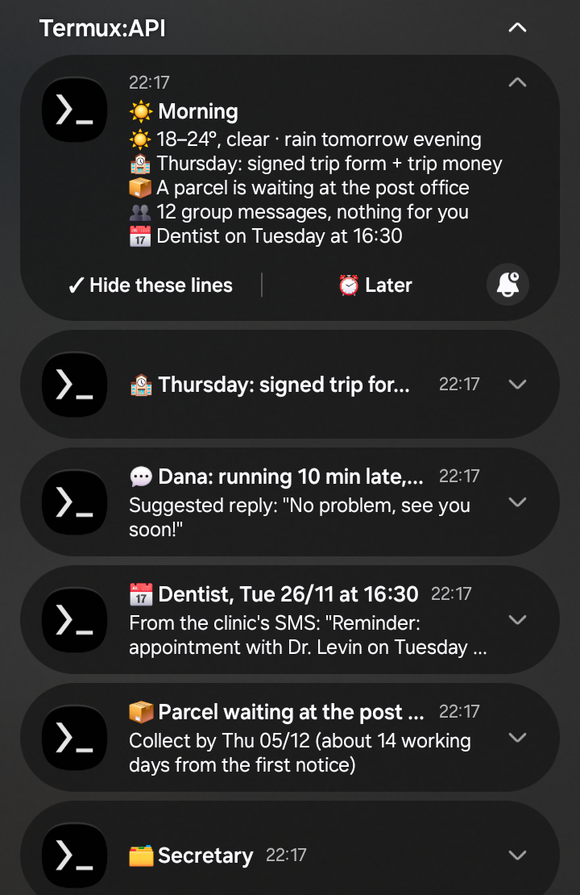
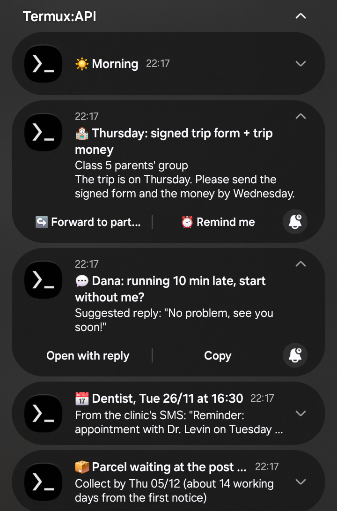

# android-secretary

A personal assistant for an Android phone's notifications, running on the phone
itself in [Termux](https://termux.dev/). A small rules engine: **sources** notice
something new (an SMS, a notification, the time of day), **rules** decide whether
it matters, **actions** do something about it. Claude reads what needs judgement:
it sorts notifications, pulls what a parent must act on out of silent school
groups, spots urgent messages from family, and writes one morning summary.

You don't configure it by hand. Claude Code, on the phone, sets it up with you
([SETUP.md](SETUP.md)), and after that you just tell it what you want changed,
from the phone or from anywhere else (see [From anywhere](#from-anywhere)).

What it does, in short:

- **Cards, not noise.** Anything with an action gets a card of its own with
  one-tap buttons (open the chat with a reply typed in, add to calendar, forward
  to your partner); known noise is cleared from the shade.
- **Morning summary** (and one when a quiet time ends): one card, one line per thing waiting.
- **School and community groups you keep silent**: what you must act on, dated,
  as cards; everything else at most a line.
- **Urgent messages from family** open their chat and are said aloud through Do
  Not Disturb; "maybe urgent" gets the same silently, and anyone else in your
  contacts only a silent card, only when it's certainly urgent.
- **Appointments, parcels, declined charges** from SMS: a card with the right button.
- **A secretary** that suggests how each notification could be handled, so
  repeated suggestions become rules. Confirmations of things you booked
  yourself get no card: if one hasn't reached your calendar half an hour later,
  a single card lists those that are missing.

<p>
  
  
</p>

<sub>Sample cards, made-up people and places.</sub>

**Nothing here approves, sends or deletes anything.** Actions only put things in
front of the owner; anything that sends (a reply, a forward) is a button the
owner taps, and even then the message opens for them to send.

It needs a lot of access to your phone: read [Safety](#safety) before you
install it, and the [Disclaimer](#disclaimer).

## Your data stays yours

Everything personal lives in two git-ignored files: `private.toml` (names,
numbers, groups, decisions) and `rules.toml` (your own rules). The repo has
examples of both: `private.example.toml` and `rules.example.toml`.
`tests/test_no_private.py` checks every tracked file against your `private.toml`
(its names, numbers and email addresses, and the extra words in its
`[public_check]` table), so a slip fails the tests before it's pushed. Claude only
sees notification text, with no tools, except for the morning email check, which
can only search and read your Gmail.

## From anywhere

You don't have to type commands or edit files, on the phone or over SSH. Turn
on Claude Code's [Remote Control](https://code.claude.com/docs/en/remote-control)
for the Claude Code session on the phone, and you can talk to it from the
Claude app (on this phone or another device) or from claude.ai/code in a
browser, like any other chat with Claude. It runs on the phone, so it can do
everything it could do there:

- "Stop showing me the Galaxy Store's update notices."
- "Make messages from my sister loud too."
- "What did the school group say this week?"
- "Take a screenshot: what's this notification?" (with adb, below)
- "Is it all still working?"

It knows how this project works from [CLAUDE.md](CLAUDE.md), and keeps to
the same promises: nothing is sent or deleted, and your data stays in your
private files.

To turn it on: in Claude Code, `/remote-control` for one session, or `/config`
> **Enable Remote Control for all sessions**. It needs a claude.ai plan (Pro,
Max, Team or Enterprise; not an API key), and the session has to keep running
on the phone: start it inside tmux (below), and it carries on when you close
Termux's window. **Read [Safety](#safety) first:** with Remote Control on,
your Claude account is a key to your phone.

The daemon itself doesn't need any of this: it runs by itself in Termux and
calls Claude when it needs a judgement. Remote Control is only for you to talk
to Claude about it.

## Safety

This gives software, and Claude, a lot of access to your phone. That's what
makes it useful, and it's also the risk. Before you install it:

- **Your Claude account becomes a key to your phone.** Claude Code on the phone
  can reach your messages, contacts, notifications and (with adb) your screen.
  With Remote Control on, anyone who gets into your claude.ai account can do the
  same. Turn on two-step verification for that account (and for the Google or
  email account you sign in with), don't stay signed in on devices you don't
  control, and turn Remote Control on only if you'll use it.
- **Keep Claude Code's permission prompts on.** Don't run it with
  `--dangerously-skip-permissions` or similar: then nothing stands between a
  mistake, or a hijacked session, and your phone.
- **Messages can try to give Claude orders.** Notifications and group messages
  come from anyone. When the daemon asks Claude for a judgement, Claude gets the
  text with no tools (the morning email check can only search and read Gmail),
  and what it says is checked where it can be (an email line must name a thread
  the search really returned; a school item must cite a real message). When you ask
  Claude Code about your messages yourself, it has a full shell, so it's told
  ([CLAUDE.md](CLAUDE.md)) to treat them as data, never as instructions.
- **adb listens on your network** once it's on a fixed port (`adb tcpip 5555`).
  Another device still needs you to accept its key on the phone: never tap
  "Allow" on a debugging prompt you didn't expect, and turn Wireless debugging
  off on networks you don't trust.
- **Your notifications go to Claude.** The text of the notifications it judges,
  including other people's messages, is sent to Anthropic to be processed, under
  your Claude account's terms and privacy settings.
- **Backups** are encrypted to your own key and pushed only to a private repo.
  Keep the secret key off the phone.

If you think you've found a security problem in the code, please report it
privately (GitHub's "Report a vulnerability" on the Security tab) rather than
in a public issue.

## Setting up

### With Claude (recommended)

You need an Android phone with [Termux](https://termux.dev/) (from
[F-Droid](https://f-droid.org/packages/com.termux/) or
[GitHub](https://github.com/termux/termux-app/releases); not Google Play's,
which is outdated) and Claude Code running in it (below). Then paste this into
Claude Code:

> Set up android-secretary on this phone for me, following
> https://github.com/j2kenton/android-secretary/blob/main/SETUP.md

Claude installs what's needed, checks each step, and asks you questions to fill
in your settings (who's closest to you, which groups you keep silent, where you
are roughly, which features you want). You do what only you can: tap through
Android's permission screens. About half an hour, most of it the questions.

### Claude Code on the phone

Claude Code runs in a small Ubuntu inside Termux (no root needed). In Termux:

```bash
pkg install -y tmux proot-distro
tmux new -A -s claude                 # keeps Claude Code running when Termux's window closes
proot-distro install ubuntu
proot-distro login ubuntu
# now inside Ubuntu:
apt update && apt install -y curl git
curl -fsSL https://claude.ai/install.sh | bash
claude --remote-control               # log in with your claude.ai account
```

Next time, `bin/claude-session` (in this folder, from Termux) opens it: it
attaches to the Claude Code session in tmux, starting it first, with Remote
Control on. `alias cc=~/android-secretary/bin/claude-session` in Termux's
`~/.bashrc` makes that one word.

### After a reboot

Nothing to type. With [Termux:Boot](https://github.com/termux/termux-boot)
installed and opened once, `bin/setup` sets the phone up so that after a
restart:

- the daemon starts again by itself;
- a card **🔌 Turn on Wireless debugging** appears (if you use adb). Android
  always turns Wireless debugging off when it restarts, and only you can turn it
  back on: tap the card for Developer options, or add the **Wireless debugging**
  Quick Settings tile (Developer options > Quick settings developer tiles) and
  flip it from the notification shade. If it's already on, or shows no IP
  address and port, turn it off and on again: after a restart that's often
  needed. Within a minute adb reconnects by itself
  (no new pairing) and the card goes away. `bin/automations adb` does the same
  by hand;
- with `bin/setup --claude-at-boot`, Claude Code starts too, in tmux with Remote
  Control on, so you can reach it from the Claude app without opening Termux.
  The first time, open it once (`bin/claude-session`) and answer its "trust this
  folder?" question, or it waits there after every reboot.

### By hand

What it needs:

- Termux:API, the app (from the same place as Termux), with notification
  access, SMS and contacts permission, and Termux allowed to display over other
  apps (so it can open apps from the background).
- Python 3.11+ in Termux: the engine uses the standard library only.
- For Claude's parts: Claude Code, logged in, in Ubuntu inside Termux (above).
- For clearing other apps' notifications, the calendar and screenshots: adb
  over Wireless debugging, put on a fixed port with `adb tcpip 5555` (again
  after each reboot). SETUP.md, step 5, has the steps.
- Optional: Termux:Boot (starts it after a reboot), and Tasker with
  AutoNotification, to press a notification's own "Mark as read" (see below).

Then, in Termux:

```bash
git clone https://github.com/j2kenton/android-secretary ~/android-secretary
cd ~/android-secretary
bin/setup                    # packages, your private.toml and rules.toml from the examples, checks
# make private.toml and rules.toml yours (the examples have comments)
bin/automations validate
bin/automations doctor       # what's still missing, and how to fix it
bin/automations start
```

## Running it

```bash
bin/automations start      # runs in its own Termux tmux session; survives the shell that started it
bin/automations status     # running? + last log lines
bin/automations doctor     # is everything in place? (read-only; says how to fix what isn't)
bin/automations logs 100
bin/automations restart    # after editing rules
bin/automations stop
```

The daemon runs natively in Termux (Python 3.11+, stdlib only), not in the
proot distro, so it keeps going when a proot/Claude session ends. After a
phone reboot it starts by itself if the Termux:Boot app is installed and was
opened once (`bin/setup` installs its script); otherwise `bin/automations start`.
All of these work from Ubuntu too, except starting it while Termux's tmux isn't
running (it would run inside Ubuntu, unable to call Claude), which is refused.

**Something stopped?** `bin/restart-all` brings everything back: it restarts
the daemon, starts Claude Code (with Remote Control) if it isn't running
(`--claude` restarts it too), reconnects adb and runs `doctor`. Run it in Termux
itself; `alias up=~/android-secretary/bin/restart-all` in Termux's `~/.bashrc`
makes it one word. For a home-screen button, install
[Termux:Widget](https://github.com/termux/termux-widget) (from the same place as
Termux) and put a two-line script in `~/.shortcuts/`:
`#!/data/data/com.termux/files/usr/bin/bash` and
`exec ~/android-secretary/bin/restart-all`.

## Cards

One rule for every card: anything with an action, or important, gets a card
of its own (its own buttons, readable, tappable, ✓ to clear). Only purely
informational lists share one card (the ☀️ overview, 🏫 Coming up, 📰 News,
🗂 Secretary's "later" items).

## Morning summary

Rule `morning-summary` (source `clock`, `at = ["05:00", "06:10"]`) posts one card: the notifications on the phone, one line each,
minus service/status noise and anything in the ignore lists in `rules.toml`.
The 06:10 run replaces the 05:00 card.

With `email = true`, Claude (the proot install, run headless by
`automations/claude.py`) reads Gmail for mail since 17:00 yesterday and adds
✉️ lines only for what matters this morning (kids, school, today's
appointments, urgent alerts). It can only search and read mail. Every ✉️ line
must name a Gmail thread id that the search really returned, or it's dropped,
so nothing made up reaches the card. If the check fails, the card says
"Email check didn't run".

With `newsletters = "@newsletters"`, the card also gets up to three 📚 lines:
the items most worth your time from the newsletters under one Gmail label
(private.toml `[newsletters]`: `label`, `max_lines`, `interests`). Claude
reads that label's emails from the last two days and any still unread from
the last five, once a day (the 06:10 card reuses the 05:00 lines), and each
newsletter is summarised only once. The same thread-id check applies, and
nothing in Gmail is changed.

Text is also saved to `var/digests/<date>.txt`. Try it with
`bin/automations fire morning-summary` (from Termux, not the proot shell).

## School groups

The owner keeps the class WhatsApp groups silent and doesn't read them.
`school-collect` saves every message from the groups in private.toml
`[school] groups`; every 5 minutes, if any came in, `school-digest` has Claude
(no tools, only those messages) pick out what a parent must act on, each with
the date it applies to. Every item must cite a message it came from. One
rolling 🏫 card lists what's still ahead (it alerts only for something new
today or tomorrow); today's and tomorrow's items are on the morning card.
Data: `var/school/messages.jsonl`, `var/school/items.jsonl`.

A muted WhatsApp chat posts no notifications, so there is nothing to read:
the group must be unmuted, with its notifications set to silent in WhatsApp.
After a message is saved, its notification is snoozed out of the shade
(`android.snooze`, via adb: Android has no other way to clear another app's
notification). That needs Wireless debugging on: the helper uses adb's current
device, else reconnects to the last one that worked (`var/adb-serial`), else
127.0.0.1:5555 (if adbd was put on a fixed port with `adb tcpip 5555`).
Without adb, messages are still collected and the notifications just stay.

## Other WhatsApp groups and Telegram channels (transport, community, building, news, ...)

Every WhatsApp group gets a profile: what's worth surfacing from it
(private.toml `[groups.profiles]`, plus built-in `school` and `active`, a group
the owner takes part in, which is left alone). A new group is classified by
Claude from its name and first messages and assigned only when it's sure;
otherwise the owner is asked, and nothing is cleared from that group until
then. Messages from watched groups are saved and snoozed out of the shade.
Every 2 minutes (only when new messages came in) Claude decides per new message: a card of its own
(significant), the 📰 "Worth knowing" summary, nothing (most messages; never
replies like congratulations or condolences), or a question for the owner.

Questions show on a ❓ card and are answered in a Claude chat:

```bash
bin/automations groups              # profiles, open questions, recent decisions
bin/automations assign "<group>" community
bin/automations resolve 2
```

Data in `var/groups/`: assign.json, messages, log (every decision), questions.

## WhatsApp chats

WhatsApp's notifications carry their chat's id (`shortcut=…@g.us` for a group),
visible via adb (`dumpsys notification`). The ids are learned as messages arrive
(`var/whatsapp-jids.json`), so 💬 buttons open that exact group or chat
(`am start -a VIEW -n com.whatsapp/.Conversation --es jid <id>`). Forwarding to
a group copies the text and opens the group (WhatsApp can't prefill a group);
until its id is known, WhatsApp's chat picker opens with the text instead.

## Mark as read (Tasker + AutoNotification)

Watched messages are cleared by pressing the notification's own "Mark as read"
(the chat is marked read in WhatsApp/Telegram), with a snooze (adb) as the
fallback when the notification is still there 4 seconds later. The phone side
sends `am broadcast -a phoneautomations.MARK_READ --es app <package> --es chat
<title filter> --es button <button text>`. Tasker setup (once):

- Profile: Event → System → Intent Received, Action `phoneautomations.MARK_READ`
- Task "Mark read": Plugin → AutoNotification → Actions, with Button Text Filter
  `%button` (case insensitive), Package Name Filter `%app`, Title Filter `%chat`.
- For Telegram's "pinned" notices, which have no title: a second profile, Intent
  Received `phoneautomations.MARK_READ_TEXT`, with a clone of that task whose
  Title Filter is empty and whose Text Filter is `%text` (the code sends
  `<chat> pinned`). Without it, a pinned notice stays until the chat's next
  message replaces it.

## Secretary

Every notification (minus the `[noise]` table) is queued by `secretary-collect`.
Every 15 minutes, if anything is queued, `secretary-triage` has Claude
(Sonnet, no tools: it sees only the notification text) give each one a
summary, a kind (act_now, reply, schedule, later, dismiss, ignore, automate),
a suggestion of how Claude could help, and a rule idea when it will recur.
The latest suggestions show on one quiet rolling card; all of them go to
`var/secretary/triaged.jsonl`, which a Claude session reviews to turn repeated
suggestions into rules. When it's confident of a good WhatsApp reply, a 💬
card offers it: "Open with reply" opens the chat (looked up in contacts) with
the reply typed in, for the owner to edit and send. It never sends anything
or acts on a notification itself.

Something significant gets a card of its own, however many notifications come
about it: Claude names the matter each is about (a support case, a bill), and
notifications on the same matter share one card, listed on it as they come
(while it's up), never lines on the summary. When a notification links to the
thing itself, the card's "🔗 Open" opens it. Senders saved in the phone's
contacts are marked, so the secretary weighs them above strangers; a social
media tag counts only from a contact or family.

A chat (a person or a group) has one card, listed message by message. A
message never shows both there and on the summary: once a chat has a card, or
gets one, all its messages go on it, its earlier summary lines move onto it,
and the question it asked stays on the card when a passing remark follows. "3 new
messages" or a bare photo shows only until the chat's first words. A chat
without a card has one line on the summary, however many messages it sends
and whenever they come: each new batch is summed up together with the lines
still showing, and replaces them. Lines already hidden with ✓ stay hidden. Tapping a
card opens what it's about: the chat, the group, the link.

## Ensemble

One card says Ensemble's state first: 🔵 needs you (a card waits, a run was
paused or stopped, or a run's process died), 🟢 running (nothing for you), or
⚪ stopped (nothing running, nothing waiting). `ensemble.state()` checks live
on the box over ssh, read-only: the run claims (and whether their processes
are alive) plus the ensemble-ops `waiting-check.py`. It runs when Ensemble
pushes a notification (whose ntfy notification is then cleared: the card
replaces it) and every 5 minutes. It nudges (a quiet sound, no pop-up, and blue: it's never urgent) only on a change to "needs you".
Away from the computer? "💤 1 hour" means "check again in an hour": no card
until then, and then one (with a nudge) only if Ensemble still needs you
(`snooze_minutes` in the rule's action changes the hour).
The morning card shows the same title.

## On-demand lookups (from a Claude session)

```bash
bin/phone tab        # the Chrome tab used most recently, incognito included (needs Wireless debugging)
bin/phone tabs -n 10
bin/phone inbox      # links shared via Share -> Termux, newest first
```

Share -> Termux runs `~/bin/termux-url-opener` (source: `share/termux-url-opener`),
which appends the link to `var/shared.tsv` and shows a toast. It opens nothing.

## Adding a rule

1. Add a `[[rule]]` block to `rules.toml` (fields documented in
   `automations/rules.py`). Use `@alias` for people and put their numbers in
   `private.toml` under `[contacts]`.
2. `bin/automations validate`
3. `bin/automations replay` dry-runs the rules over past SMS, showing which
   messages would have fired.
4. `bin/automations fire <rule>` runs the rule's actions once, to see them.
5. `bin/automations restart`

## Extending

- **New trigger:** subclass `Source` in `automations/sources.py`, register it
  in `SOURCES`. The first poll only sets a baseline, so old items never fire.
- **New action:** a function `(event, **opts)` in `automations/actions.py`,
  registered in `ACTIONS`. Text options may use `{field}` placeholders from
  the event.
- **Android access:** add wrappers to `automations/android.py` (Termux:API
  and `am`), always with a timeout.

## Backup

Every night at 03:00 (`backup` rule) what isn't in git — `private.toml`,
`rules.toml`, the decisions in `var/` (not logs or message copies), Claude's
memory notes, the Tasker export (`Tasker/configs/user/backup.xml`: re-export
after changing a profile) and the Termux package list — is put in one tar,
encrypted with [age](https://age-encryption.org) to `backup.pub` (replace it with
your own public key), and pushed when it changed to the `backup` branch of a
**private** repo: the git remote named `backup`, never `origin`
(`git remote add backup <url of a private repo>`). Without that remote, or if
GitHub says it's public, the backup is kept locally and not pushed. The secret
key is the owner's, kept off the phone. Restore:

```bash
git fetch backup backup
git show backup/backup:backup.tar.gz.age | age -d -i key.txt | tar xz -C ~
```

Tasker also has a second profile: Intent Received `phoneautomations.DISMISS`
→ AutoNotification Cancel with Package Name Filter `%app`, Title Filter `%chat`.

## Phone setup it relies on

- Termux:API app, with SMS permission and notification access.
- Termux allowed to display over other apps, so it can open apps from the
  background.
- Termux keeps a wake lock while the daemon runs.

## Tests

```bash
python -m unittest discover -s tests
```

Tests never touch your live state: under unittest, `var/` is a temporary folder,
`private.toml` isn't read, and the rules are `rules.example.toml`. Only
`tests/test_no_private.py` reads your `private.toml`, to check nothing from it is
in the code.

## Languages and regions

It understands messages in English and Hebrew so far, and knows a few regional
formats (appointment and card texts, a postal service's parcel notices, a school
app). Quiet times currently include Shabbat (`[quiet]` in `private.toml`), and
groups that post a weekly schedule can be asked about it. Contributions for more
languages, regions and quiet times are welcome: most of it is in
`automations/extract.py`, `parcels.py`, `quiet.py` and the rules.

## Disclaimer

This is a personal project, shared as is in case it's useful, with **no
warranty of any kind**. You use it at your own risk, and you're responsible for
how you use it: for what it does on your phone, for anything it misses, hides
or gets wrong (it may clear or overlook a notification that mattered), for
keeping your accounts and devices secure, and for following the laws and the
terms of the services involved where you are, including other people's privacy
when it handles their messages. It's not a safety or emergency tool: don't rely
on it to see an alert. To the fullest extent the law allows, the authors aren't
liable for any loss or damage from using it (see the [LICENSE](LICENSE)).

Not affiliated with or endorsed by Anthropic, Google, Samsung, Meta, WhatsApp,
Telegram, Termux or any other company or app it mentions; their names and
trademarks belong to them.

## Licence

MIT: see [LICENSE](LICENSE).
